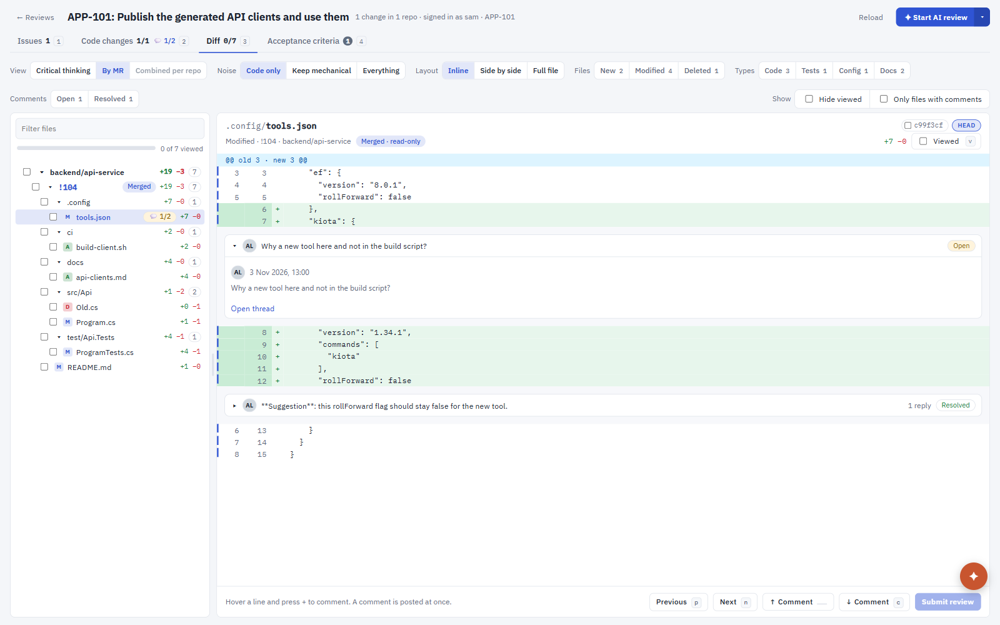

# Code Diff Tool

Code Diff Tool is a desktop app for reviewing merge requests and pull requests, from GitLab and from GitHub, together with the issues that they belong to. One review holds all the code changes and all the issues of one piece of work. The app shows the diffs, the threads and the acceptance criteria in one place, and an AI tool can help with the review. It runs on Windows, macOS and Linux.

The picture shows made-up data. `docs/FEATURES.md` describes every feature with more pictures.

## Features

- A review holds one or more code changes (merge requests or pull requests, from any mix of repos and hosts) and one or more issues (Jira issues or spec files).
- The Issues tab lists the issues with their status and acceptance criteria. You can paste Jira keys or add spec files (`.md`, `.txt` or `.html`).
- The Code changes tab lists the changes with their state, pipeline, approvals, threads and review status. It shows if a change is behind its target branch. Every column sorts. You can approve, mark as ready or mark as draft from the table.
- The tabs are Code changes, Summarised, Diff, Issues and Acceptance criteria.
- The Diff tab shows the files of all the changes in a tree. You can read the diff inline, side by side or as a full file. A noise filter hides blank lines, comments and imports. The characters that changed inside a line are marked.
- Filters by file status, file type and comments (open or resolved). A filter with no button on shows everything.
- You can pick one commit of a change and see only what it changed, and mark files and commits as viewed. Marking HEAD as viewed marks the commits before it.
- Comments, replies and review submissions go to GitLab or GitHub. Your comments stay as drafts until you post them.
- Summarised is a page that an AI tool writes when you open the Summarised tab, with the model sonnet. It is a page of at most 10 sections for a bug hunt: only the places where a bug can be spotted, in reading order, each with one paragraph, compact code, its files and its own thread. The app adds the last section, "Everything else", with every file and change that the page leaves out. Accept a section to mark its files as viewed and collapse it. An index in the left column goes to each section.
- The Acceptance criteria tab checks each criterion of the issues against the code, and can suggest a comment for a criterion that is not met.
- The AI review reads the whole review and leaves draft comments for you to read first. A chat panel answers questions about the change. Claude Code is the default AI tool. Codex and a custom command also work.
- Themes: System, Tokyo Night, Dracula, Nord, Gruvbox Dark, Solarized Dark and Paper.
- You can start a review from outside the app, with a second start, a `codediff://` link or flags.

## License

The app uses the MIT license. See the file `LICENSE`. You can use, copy, change and share the code, also for commercial work, if you keep the copyright line and the license text. The software has no warranty.

The app is not affiliated with Anthropic, OpenAI, GitLab, GitHub or Atlassian. It uses their public interfaces with your own tokens. It runs the AI tool that you install and license on your own.

## More documentation

- `docs/FEATURES.md` describes every product feature.
- `docs/TECH-STACK.md` describes the stack, the architecture, the data formats, the tests, the pipelines and the decisions.
- `CLAUDE.md` holds the working rules for agents and people who change the code.

## Keys

- Tabs: `1` to `5` pick a tab. Ctrl+Tab and Ctrl+Shift+Tab go to the next and the prior tab.
- File tree: the arrow keys move through the rows, Left and Right fold and unfold, and `*` unfolds everything below the row.
- Files: `n` and `p` open the next and the prior file. `v` marks the open file as viewed and goes on to the next file. Shift+V takes the mark away. With a commit chosen, `v` and Shift+V act on that commit only.
- Comments: `c` goes to the next comment in the open file.

## Download

The installers for Windows and macOS are on the Releases page of this repository. A release has them only after the maintainer builds them, so a new minor or patch release can come without files. The installers are not signed.

- Windows: run `Code-Diff-Tool-<version>-win-x64.exe`. Windows SmartScreen warns about an unknown publisher. Choose "More info", then "Run anyway".
- macOS: open the `.dmg` for your Mac and drag the app to Applications. Use `arm64` for Apple Silicon and `x64` for an Intel Mac. The app is not notarized. The first time, open it with a right click and choose "Open".

## Requirements

- Node.js 22.18 or later, to build and run from source. The scripts in `scripts/` run TypeScript directly.
- `git`, because the app reads the code from your local clones.
- A token for each host that you use: GitLab, GitHub and Jira. The Prerequisites screen of the app explains how to make each one.
- Optional: Claude Code, Codex or another AI tool on the path of your login shell.

## Develop

    npm install
    npm run dev

`npm install` also sets up a pre-commit hook that checks the files that you commit.

`npm run dev` starts the app with hot reload. A change in the interface shows at once. A change in the main process restarts the app.

To run the app from the source with no setup, use `npm run app`. The files `launch.sh`, `launch.ps1` and `launch.cmd` in the root of the repository do the same, from any folder, for bash, PowerShell and cmd. The script pulls the newest code when you are on `main` with no local changes. It installs the packages when the lock file changed, builds the code and starts the app. It removes the `ELECTRON_*`, `CLAUDE_*` and `NODE_ENV` variables that a parent shell can pass on. Point a shortcut at one of the files to start the app from the source code.

Other commands:

- `npm test` runs the unit tests.
- `npm run test:e2e` builds the app, starts it and runs the end-to-end tests against a fake forge and fake AI tools.
- `npm run typecheck` checks the types.
- `npm run lint` checks the code. `npm run lint:fix` applies the safe fixes. `npm run format` formats everything.
- `npm run check` runs the typecheck, the lint, the format check and the unit tests.
- `npm run dist` builds an installer for the system you are on. The version is the next release version with a draft mark, for example `0.3.0-draft.3`, so a local file is never mistaken for a release.
- `npm run screenshots` takes the pictures of the documentation, with made-up data.

Each merge to `main` makes a new release with a version and a tag. The commit type decides the version: `feat` gives a minor version, `feat!:` or a `BREAKING CHANGE:` line gives a major version, and every other type gives a patch version.

The interface is React. The main process reads git, calls the hosts and runs the AI tools. Run `npm run icon` to draw the icon again from `build/icon.svg`.

## Contribute

The branch `main` is protected. A change goes in a branch and reaches `main` through a pull request.

- Give the pull request a title in the form `type: description`. The types are `feat`, `fix`, `perf`, `refactor`, `docs`, `test`, `chore`, `ci`, `build`, `style` and `revert`. Squash merge the pull request, because the title becomes the commit message.
- Bring `main` into the branch before you merge. The checks must pass on that result.
- Run `npm run check` before you push. A pre-commit hook checks the files that you commit.

## How it works

- The app reads GitLab, GitHub and Jira over their REST interfaces. It saves each token per host, encrypted with the operating system, and never sends a token to the page.
- It finds your clones by the `origin` remote of each repo in a workspace folder that you choose, and reads the code with `git`.
- A review is a folder under `.code-diff/` in the workspace. It keeps the list of changes and issues, your draft comments and the results of the AI tools.
- The AI tools run as child processes with a read-only tool set. They read a folder of files that the app writes for them, and never post anything. The app turns their answers into drafts that you read first.

## Test the app

The end-to-end tests start the real app. They set the environment variable `CODEDIFF_TEST=1` and point the app at a fake forge and fake AI tools, so a test never reaches a real service. Set `CODEDIFF_SHOW_WINDOW=1` to watch a test run.
